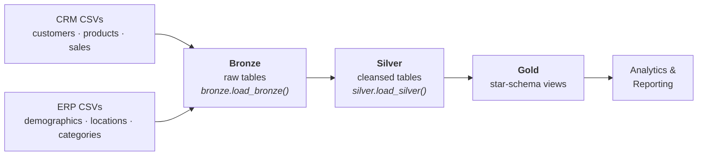
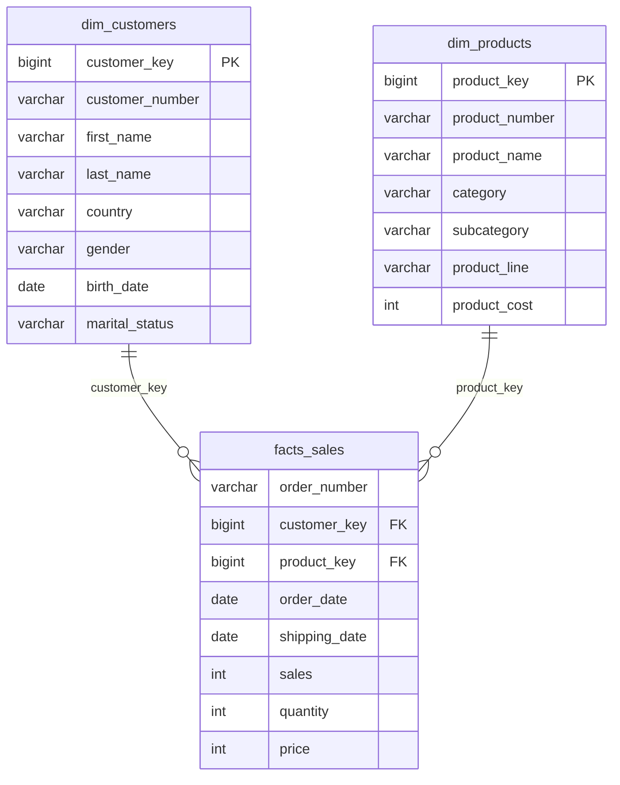
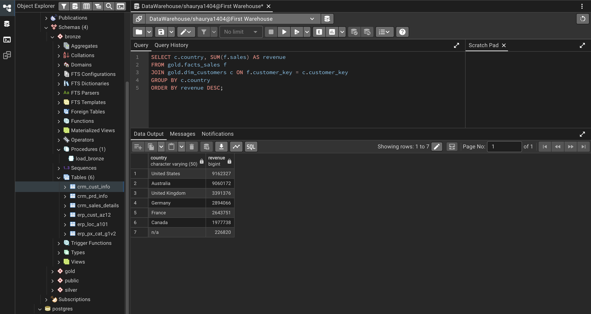

# SQL Data Warehouse (PostgreSQL)

An end-to-end data warehouse that integrates messy CRM and ERP extracts (~150K rows across 6 sources) into a clean **star schema** for analytics. It uses the **Medallion Architecture** (Bronze → Silver → Gold) and is written entirely in PL/pgSQL.

**Skills demonstrated:** data modeling (star schema, surrogate keys) · ETL with stored procedures · data cleansing and cross-system integration · data quality testing · documentation

---

## Architecture



| Layer | What happens | Implementation |
|---|---|---|
| **Bronze** | Raw CSVs loaded as-is, so every value can be traced back to its source | Truncate + bulk `COPY`, in a stored procedure |
| **Silver** | Cleansing, standardization, deduplication, and key alignment across systems | Truncate + `INSERT … SELECT`, in a stored procedure with per-step timing logs |
| **Gold** | Sources integrated into a business-ready star schema | Views with surrogate keys and business-friendly names |

---

## Data Model



Column-level documentation is in [`docs/data_catalog.md`](docs/data_catalog.md).

---

## Data Problems Solved

The source data was deliberately messy. These are the main issues I found by profiling it and how the Silver layer fixes each one:

| Problem | Solution |
|---|---|
| Duplicate customer records | Kept the most recent record per customer using `ROW_NUMBER()` |
| CRM and ERP use different key formats (`NAS` prefixes, dashes) | Normalized keys so all three customer sources join cleanly |
| Product key embeds a category ID used by another system | Split it into two derived join keys |
| Overlapping or invalid product validity dates | Rebuilt end dates with `LEAD()` so product versions never overlap |
| Order dates stored as integers, including zeros and malformed values | Validated them and converted to `DATE`; invalid values become `NULL` |
| `sales ≠ quantity × price`, plus negative or missing values | Recomputed values from the business rule |
| Inconsistent codes (`M`/`F`, `US`/`USA`/`DE`, blanks) | Mapped them to standard, readable values |
| Gender recorded in both systems, sometimes conflicting | CRM is treated as the source of truth, with ERP filling the gaps |

---

## Data Quality Testing

The [`tests/`](tests/) folder holds the checks used to validate each layer. Every check is written so that the expected result is **zero rows**. They cover:

- primary-key uniqueness and nulls
- whitespace and standardization
- referential integrity between CRM and ERP, and between facts and dimensions
- date chronology
- the sales business rule
- duplicates introduced by joins

Example star schema analysis, revenue by country:

```sql
SELECT c.country, SUM(f.sales) AS revenue
FROM gold.facts_sales f
JOIN gold.dim_customers c USING (customer_key)
GROUP BY c.country
ORDER BY revenue DESC;
```



---

## Running It

You need PostgreSQL 13+ and a role allowed to use server-side `COPY`. In `scripts/bronze/load_bronze_proc.sql`, update the file paths to point to your local `datasets/` folder, then run:

```bash
psql -d postgres      -c 'CREATE DATABASE "DataWarehouse";'
psql -d DataWarehouse -c 'CREATE SCHEMA bronze; CREATE SCHEMA silver; CREATE SCHEMA gold;'

psql -d DataWarehouse -f scripts/bronze/ddl_bronze.sql -f scripts/bronze/load_bronze_proc.sql -c 'CALL bronze.load_bronze();'
psql -d DataWarehouse -f scripts/silver/ddl_silver.sql -f scripts/silver/load_silver_proc.sql -c 'CALL silver.load_silver();'
psql -d DataWarehouse -f scripts/gold/ddl_gold.sql
```

---

## Repository Structure

```
datasets/        source CSVs (source_crm/, source_erp/)
docs/            data catalog for the Gold layer
scripts/         init_database.sql, plus bronze/, silver/, gold/ DDL and load procedures
tests/           data quality checks for Silver and Gold
```
